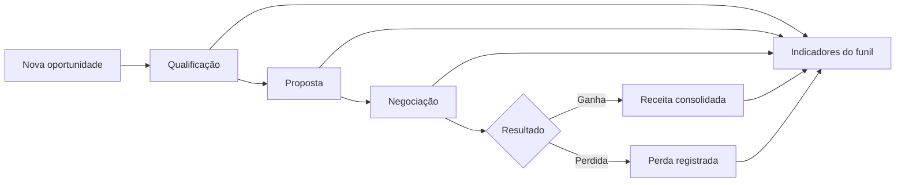

# 📈 Pipeline Comercial em Python

> Projeto que traduz um processo comercial real em regras de software e indicadores de gestão, conectando **experiência de negócios + lógica de programação + visão analítica**.

## Problema

Equipes comerciais precisam acompanhar oportunidades, estágio de negociação, valor potencial, conversão e resultado. Quando esse processo não é estruturado, decisões ficam dependentes de controles manuais e pouca visibilidade do funil.

## Solução

Este projeto simula um pipeline comercial em Python capaz de registrar oportunidades, acompanhar evolução e consolidar indicadores básicos de desempenho.

A proposta não é apenas praticar sintaxe: é demonstrar como um processo conhecido do mundo de negócios pode ser convertido em **dados, estados, regras e métricas**.

## Contexto de negócio

O projeto se conecta diretamente à minha trajetória em relacionamento com clientes, desenvolvimento comercial e serviços financeiros. Isso permite trabalhar software a partir de um problema que conheço pelo lado operacional e executivo.

## Funcionalidades

- cadastro de oportunidades;
- registro de cliente e produto/serviço;
- controle do estágio da negociação;
- listagem de oportunidades;
- cálculo do valor total do pipeline em aberto;
- contagem de oportunidades ganhas e perdidas;
- cálculo da taxa de conversão;
- consolidação do valor de vendas ganhas.

## Fluxo de negócio

## O que este projeto demonstra

- tradução de processo de negócio em regras de sistema;
- modelagem de estados e transições;
- organização de dados com listas e dicionários;
- criação de indicadores simples;
- raciocínio sobre fluxo, entrada, regra e resultado;
- capacidade de conectar tecnologia a um processo comercial real.

## Stack e conceitos

**Python** · Funções · Listas · Dicionários · Condicionais · Loops · Regras de negócio · Indicadores comerciais

## Decisões de implementação

A versão atual foi mantida propositalmente simples para tornar o fluxo de negócio transparente. Antes de adicionar banco de dados, API ou framework, o foco foi garantir que as regras principais do funil fossem compreensíveis e verificáveis.

## Limitações atuais

- dados mantidos apenas em memória;
- ausência de autenticação;
- ausência de persistência em banco;
- indicadores ainda básicos;
- sem interface web ou API.

Essas limitações são intencionais e definem a próxima etapa de evolução do projeto.

## Roadmap

1. persistência com PostgreSQL;
2. API REST com FastAPI;
3. testes automatizados;
4. filtros por período, estágio e responsável;
5. dashboard de conversão e valor por etapa;
6. forecast simples de receita;
7. análise de aging das oportunidades.

## Como explicar em entrevista

> "Eu já conhecia o pipeline comercial pelo lado de negócio. Neste projeto, transformei o fluxo em estados, regras e indicadores. O valor para mim foi exercitar a tradução entre necessidade de negócio e comportamento de sistema — uma competência importante em Business Analysis, Systems Analysis, Product Operations e desenvolvimento de soluções corporativas."

## Próxima evolução de maior valor

A evolução prioritária é transformar o projeto em uma pequena aplicação com **PostgreSQL + API REST + testes**, preservando a lógica de negócio já construída e tornando o case mais próximo de um sistema empresarial real.

## Autor

**Daniel Fernando Martins**  
Profissional com experiência em serviços financeiros, relacionamento com clientes e desenvolvimento comercial, ampliando sua atuação na interseção entre **negócios, tecnologia, dados e sistemas**.
